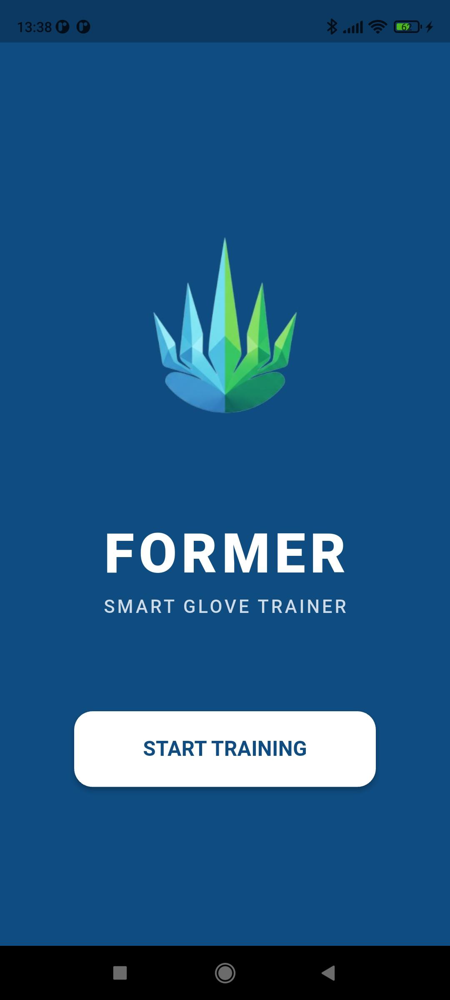
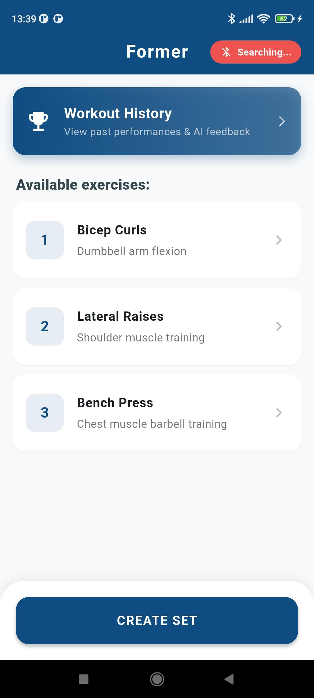
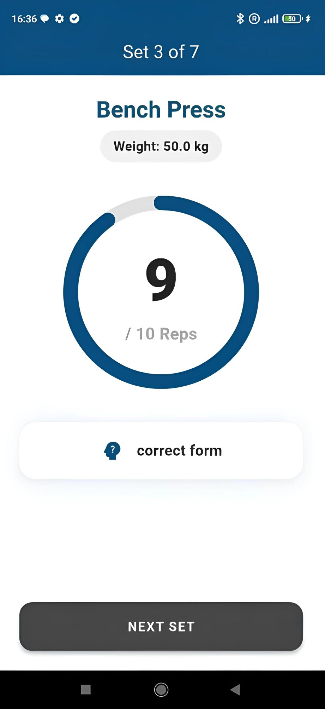
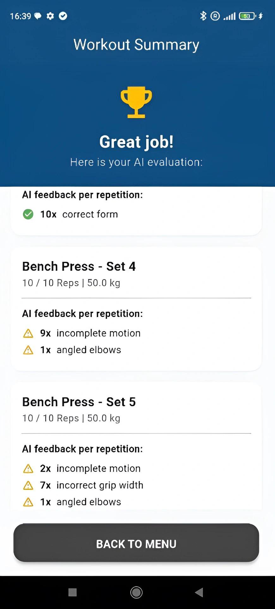
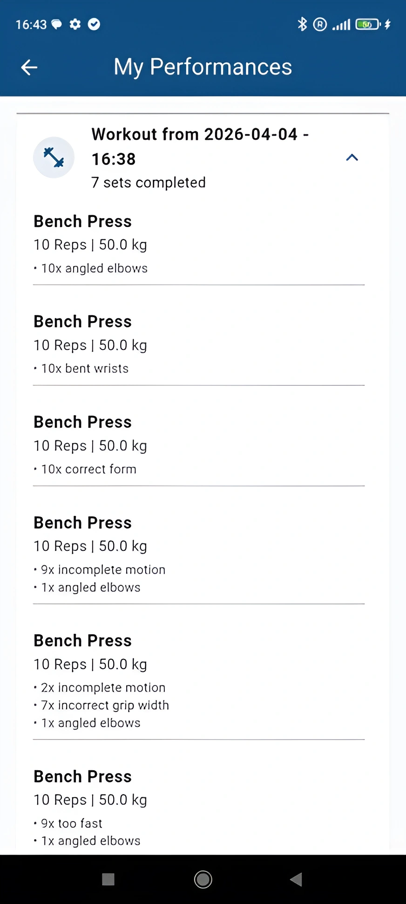

# Former Glove – App

Android app from the diploma thesis "Former Glove" at HTL Braunau (focus: Coding & AI, school year 2025/26).

## Project
Smart training gloves analyze how exercises are performed during strength training. The app shows AI feedback and a repetition counter in real time.

## Team split (two-person team)
- **Kevin Silajdzic:** smartphone app (this repository)
- **Daniel Jones:** hardware, glove firmware and AI model

## Screenshots

  
  
  
  
  

From left to right: start screen, menu, live training, workout summary, workout history.

## App features
- Select exercises and set sets, repetitions and weight
- Live training with automatic repetition counting and AI feedback
- Bluetooth Low Energy connection with automatic reconnect
- Per-set summary and saved training history

## Tech stack
Flutter/Dart, Provider, flutter_reactive_ble, permission_handler, shared_preferences

## Note
This is a prototype. The app only works fully together with the gloves. The AI model is currently trained for bench press only, and the selected exercise is not yet sent to the glove.